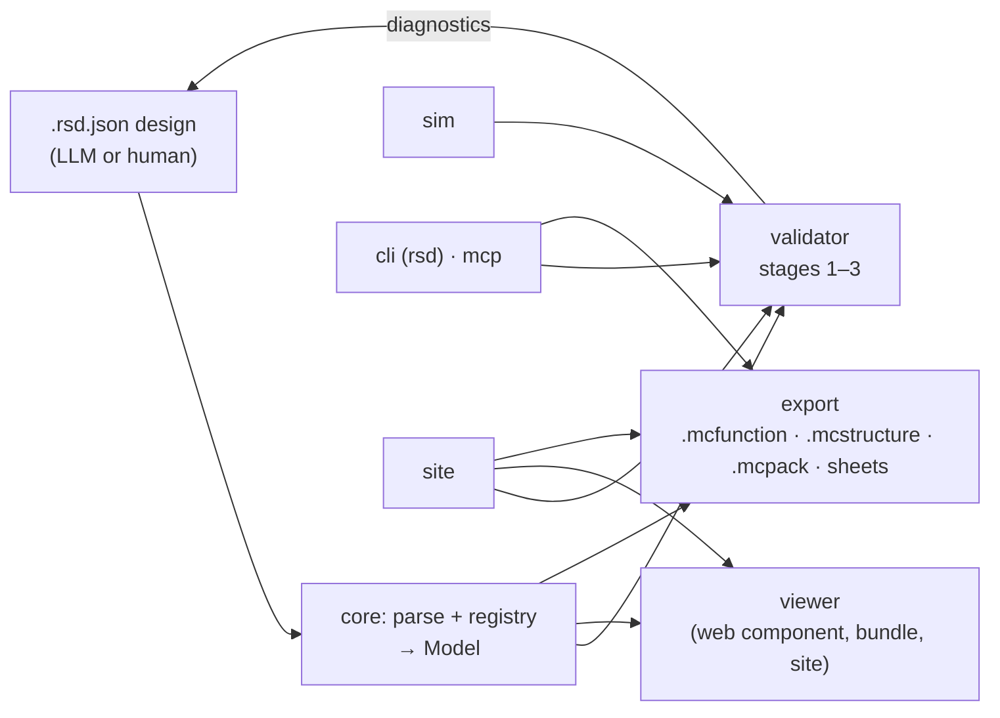

# Architecture

> Skeleton from M0. Each milestone fills in the parts it builds.

One parser and registry produce a single block model. The validator, viewer and exporters all read that model, so
what you inspect in the browser is exactly what gets placed in game. Diagnostics loop back to the author until the
design is clean.

## Package map

| Package                 | Holds                                            | Depends on                     |
| ----------------------- | ------------------------------------------------ | ------------------------------ |
| `@dustwright/core`      | Schema, parser, normaliser, registry, editions   | nothing                        |
| `@dustwright/sim`       | Tick-based Bedrock redstone simulator            | core                           |
| `@dustwright/validator` | Stage 1 to 3 rules, diagnostics                  | core, sim                      |
| `@dustwright/viewer`    | Three.js viewer web component                    | core                           |
| `@dustwright/export`    | `.mcfunction`, `.mcstructure`, `.mcpack`, sheets | core                           |
| `@dustwright/mcp`       | MCP server over stdio                            | core, validator, sim, export   |
| `dustwright` (cli)      | The `dustwright` / `rsd` binary                  | everything except viewer, site |
| `apps/site`             | Public static website and playground             | packages                       |

Packages depend inward only: everything depends on `core`; nothing depends on `viewer`, `cli` or `site` (the site
alone renders with the viewer). A test (`test/dependency-graph.test.ts`) enforces the edges and the absence of
cycles. Each package exports its public API from one `index.ts`.

Command logic lives in the package it belongs to (`validator`, `export`, ...) as pure functions that return JSON
and files. The CLI and the MCP server are both thin adapters over those functions, so `mcp` never depends on
`cli`. The CLI's `bundle` command embeds the viewer's prebuilt single-file bundle as a build artifact, not as a
code dependency.

## Core model

Filled in at M1.

## Extension points

Filled in at M1 (block, validator rule, edition, format) and M3 (exporter).

## Edition profiles

Filled in at M1.
