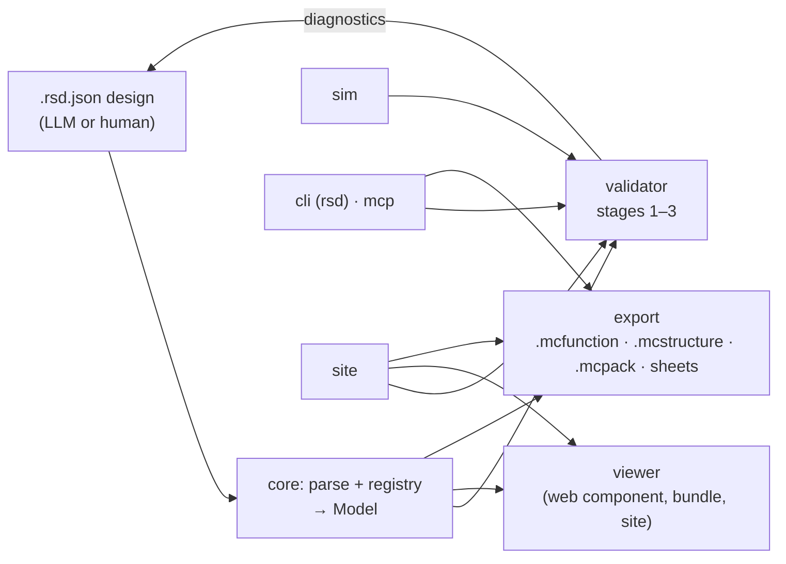

# Architecture

> Skeleton from M0. Each milestone fills in the parts it builds.



One parser and registry produce a single block model. The validator, viewer and exporters all read that model, so
what you inspect in the browser is exactly what gets placed in game. Diagnostics loop back to the author until the
design is clean.

## Package map

| Package                 | Holds                                            | Depends on                     |
| ----------------------- | ------------------------------------------------ | ------------------------------ |
| `@dustwright/core`      | Schema, parser, normaliser, registry, editions   | nothing                        |
| `@dustwright/sim`       | Tick-based Bedrock redstone simulator            | core                           |
| `@dustwright/validator` | Stage 1 to 3 rules, diagnostics                  | core, sim                      |
| `@dustwright/viewer`    | Three.js viewer web component                    | core                           |
| `@dustwright/export`    | `.mcfunction`, `.mcstructure`, `.mcpack`, sheets | core                           |
| `@dustwright/mcp`       | MCP server over stdio                            | core, validator, sim, export   |
| `dustwright` (cli)      | The `dustwright` / `rsd` binary                  | everything except viewer, site |
| `apps/site`             | Public static website and playground             | packages                       |

Packages depend inward only: everything depends on `core`; nothing depends on `viewer`, `cli` or `site` (the site
alone renders with the viewer). A test (`test/dependency-graph.test.ts`) enforces the edges and the absence of
cycles. Each package exports its public API from one `index.ts`.

Command logic lives in the package it belongs to (`validator`, `export`, ...) as pure functions that return JSON
and files. The CLI and the MCP server are both thin adapters over those functions, so `mcp` never depends on
`cli`. The CLI's `bundle` command embeds the viewer's prebuilt single-file bundle as a build artifact, not as a
code dependency.

## Core model

Everything downstream consumes one normalised model from `@dustwright/core`. Air is omitted; positions are keyed
`"x,y,z"`.

```ts
type Pos = readonly [x: number, y: number, z: number];
type StateValue = string | number | boolean;
interface Block {
  type: string;
  states: Record<string, StateValue>;
} // every state filled (defaults applied)
interface Model {
  format: "rsd/1";
  meta: Meta; // name, slug (always set), description, edition, gameVersion
  size: Pos; // bounding box from the grid
  blocks: ReadonlyMap<string, Block>; // "x,y,z" -> block, air omitted
  ports: { inputs: Port[]; outputs: Port[] };
  tests: TestCase[];
  steps: Step[]; // normalised to positions; default one per non-empty layer
  annotations: Annotation[];
  registryVersion: string; // pinned vanilla-data version
  ext?: Record<string, unknown>; // carried through untouched
}
```

`parse(json)` and `parseText(text)` never throw and never mutate their argument; they return a model only when
stage 1 finds no errors. `parseText` rejects oversized (2 MB) and over-deep (8) input before `JSON.parse`. The
schema check uses a validator precompiled from `packages/core/schema/rsd-1.json` (`pnpm gen`), so nothing compiles
code at runtime. A door is one block in the model; its upper half is a property of the mapping (`upper`), and the
cell above it must be air.

Pipeline inside `parse`: guards (size, depth, node budget) → `format` (E010) → hard limits (E013) → JSON Schema
(E001) → bounding box (E007) → grid shape (E002) → legend specs (E004, E005, W106) → cells (E003) → overrides
(E008, E009) → extra cells (E008, E009) → non-air count (E013) → ports, tests, annotations, steps (E008, E011) →
slug (E012).

## Extension points

- **Block:** one registry JSON file in `packages/core/registry/` (validated against
  `packages/core/schema/registry.json`), one viewer geometry builder (named in `GEOMETRY_BUILDERS`), one sim
  behaviour class (named in `SIM_CLASSES`). `test/registry.test.ts` asserts all three for every type and checks
  every Bedrock ID and state against the pinned Mojang data.
- **Validator rule:** a pure `Rule` (`code`, `stage`, `severity`, `editions`, `run`) added to the one `RULES`
  array in `packages/validator/src/rules/`. Codes are unique (tested) and documented in the catalogue
  `DIAGNOSTIC_CODES` (core), from which `docs/diagnostics.md` is generated.
- **Exporter:** `Exporter { id, target, export(model, opts): { files, diagnostics } }`. Exporters return files;
  only the CLI writes them (M3).
- **Edition:** one `EditionProfile` per edition (below).
- **Format:** a new major version adds `migrations/rsd-N-to-M.ts`. Additive optional keys stay in `rsd/1`.
- **Tool data:** the reserved `ext` object.

## Edition profiles

`meta.edition` is the switch. `EditionProfile { id, rules, mechanics, mapping, exporters, docs }` is defined in
core; the profile objects live in `@dustwright/validator` (`BEDROCK_PROFILE`, `JAVA_PROFILE`), which depends on
`sim` for mechanics and `export` for exporters. The Java profile is a stub whose only rule is E015 until M9. See
`docs/adr/0004-edition-profiles.md`.

## Generated files

| File                                                       | Source                            | Command                                            | CI check          |
| ---------------------------------------------------------- | --------------------------------- | -------------------------------------------------- | ----------------- |
| `packages/core/src/generated/registry.ts`                  | `packages/core/registry/*.json`   | `pnpm gen`                                         | `pnpm gen:check`  |
| `packages/core/src/generated/validate-rsd.ts`, `schema.ts` | `packages/core/schema/rsd-1.json` | `pnpm gen`                                         | `pnpm gen:check`  |
| `docs/bedrock-mapping.md`                                  | registry                          | `pnpm docs:gen` (same text as `rsd registry dump`) | `pnpm docs:check` |
| `docs/diagnostics.md`                                      | `DIAGNOSTIC_CODES` + `RULES`      | `pnpm docs:gen`                                    | `pnpm docs:check` |
| `docs/verify-in-game.md`                                   | registry `verify` notes           | `pnpm docs:gen`                                    | `pnpm docs:check` |
