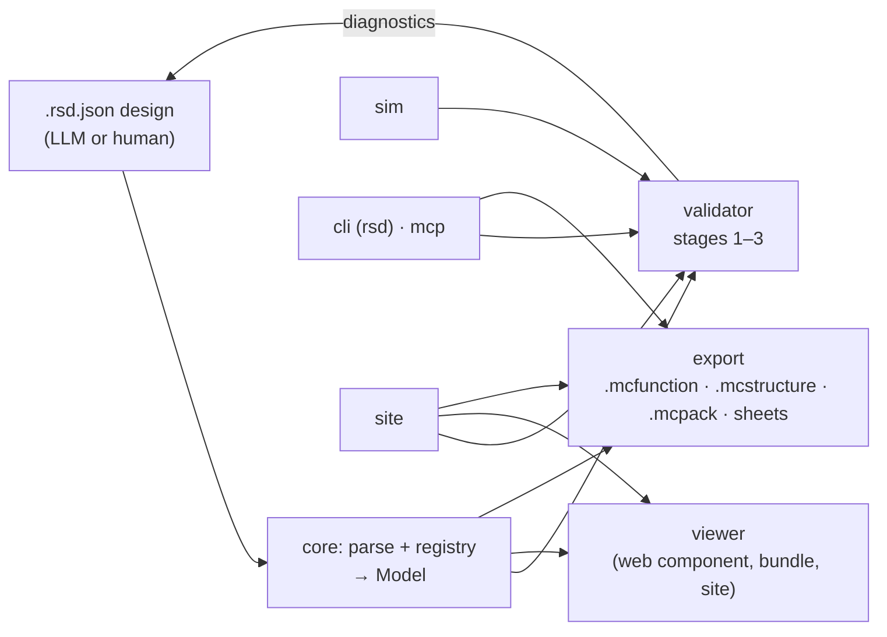

# Architecture

> Skeleton from M0. Each milestone fills in the parts it builds.



One parser and registry produce a single block model. The validator, viewer and exporters all read that model, so
what you inspect in the browser is exactly what gets placed in game. Diagnostics loop back to the author until the
design is clean.

## Package map

| Package                 | Holds                                             | Depends on                     |
| ----------------------- | ------------------------------------------------- | ------------------------------ |
| `@dustwright/core`      | Schema, parser, normaliser, registry, editions    | nothing                        |
| `@dustwright/sim`       | Tick-based Bedrock redstone simulator             | core                           |
| `@dustwright/validator` | Stage 1 to 3 rules, diagnostics, edition profiles | core, sim, export              |
| `@dustwright/viewer`    | Three.js viewer web component                     | core, validator (static), sim  |
| `@dustwright/export`    | `.mcfunction`, `.mcstructure`, `.mcpack`, sheets  | core                           |
| `@dustwright/mcp`       | MCP server over stdio                             | core, validator, sim, export   |
| `dustwright` (cli)      | The `dustwright` / `rsd` binary                   | everything except viewer, site |
| `apps/site`             | Public static website and playground              | packages                       |

Packages depend inward only: everything depends on `core`; nothing depends on `viewer`, `cli` or `site` (the site
alone renders with the viewer). A test (`test/dependency-graph.test.ts`) enforces the edges and the absence of
cycles. Each package exports its public API from one `index.ts`.

Command logic lives in the package it belongs to (`validator`, `export`, ...) as pure functions that return JSON
and files. The CLI and the MCP server are both thin adapters over those functions, so `mcp` never depends on
`cli`. The CLI's `bundle` command embeds the viewer's prebuilt single-file bundle as a build artifact, not as a
code dependency.

## Core model

Everything downstream consumes one normalised model from `@dustwright/core`. Air is omitted; positions are keyed
`"x,y,z"`.

```ts
type Pos = readonly [x: number, y: number, z: number];
type StateValue = string | number | boolean;
interface Block {
  type: string;
  states: Record<string, StateValue>;
} // every state filled (defaults applied)
interface Model {
  format: "rsd/1";
  meta: Meta; // name, slug (always set), description, edition, gameVersion
  size: Pos; // bounding box from the grid
  blocks: ReadonlyMap<string, Block>; // "x,y,z" -> block, air omitted
  ports: { inputs: Port[]; outputs: Port[] };
  tests: TestCase[];
  steps: Step[]; // normalised to positions; default one per non-empty layer
  annotations: Annotation[];
  registryVersion: string; // pinned vanilla-data version
  ext?: Record<string, unknown>; // carried through untouched
}
```

`parse(json)` and `parseText(text)` never throw and never mutate their argument; they return a model only when
stage 1 finds no errors. `parseText` rejects oversized (2 MB) and over-deep (8) input before `JSON.parse`. The
schema check uses a validator precompiled from `packages/core/schema/rsd-1.json` (`pnpm gen`), so nothing compiles
code at runtime. A door is one block in the model; its upper half is a property of the mapping (`upper`), and the
cell above it must be air.

Pipeline inside `parse`: guards (size, depth, node budget) → `format` (E010) → hard limits (E013) → JSON Schema
(E001) → bounding box (E007) → grid shape (E002) → legend specs (E004, E005, W106) → cells (E003) → overrides
(E008, E009) → extra cells (E008, E009) → non-air count (E013) → ports, tests, annotations, steps (E008, E011) →
slug (E012).

## Extension points

- **Block:** one registry JSON file in `packages/core/registry/` (validated against
  `packages/core/schema/registry.json`), one viewer geometry builder (named in `GEOMETRY_BUILDERS`), one sim
  behaviour class (named in `SIM_CLASSES`). `test/registry.test.ts` asserts all three for every type and checks
  every Bedrock ID and state against the pinned Mojang data. Support faces (`faces.bedrock`) come from the
  in-game measurement in `docs/ingame/`, and `packages/core/test/supports.test.ts` keeps them in step.
- **Validator rule:** a pure `Rule` (`code`, `stage`, `severity`, `editions`, `run`) added to the one `RULES`
  array in `packages/validator/src/rules/`. Codes are unique (tested) and documented in the catalogue
  `DIAGNOSTIC_CODES` (core), from which `docs/diagnostics.md` is generated.
- **Exporter:** `Exporter { id, target, export(model, opts): ExportResult | Promise<ExportResult> }`, where
  `ExportResult` is `{ files, diagnostics }`; callers always await. Exporters return files;
  only the CLI writes them (M3).
- **Edition:** one `EditionProfile` per edition (below).
- **Format:** a new major version adds `migrations/rsd-N-to-M.ts`. Additive optional keys stay in `rsd/1`.
- **Tool data:** the reserved `ext` object.

## Edition profiles

`meta.edition` is the switch. `EditionProfile { id, rules, mechanics, mapping, exporters, docs }` is defined in
core; the profile objects live in `@dustwright/validator` (`BEDROCK_PROFILE`, `JAVA_PROFILE`), which depends on
`sim` for mechanics and `export` for exporters. The Java profile is a stub whose only rule is E015 until M9. See
`docs/adr/0004-edition-profiles.md`.

## Viewer

`@dustwright/viewer` turns each block into procedural boxes (`geometry.ts`, one builder per registry
`geometry.builder`, colours from an original palette) and draws all of them with three instanced meshes: solid
parts, ghosted parts (layers above the cut, 15% opacity) and direction arrows. Changing the layer, isolate,
explode, overlay or step rebuilds the instance buffers; rendering is on demand. Picking tests the ray against each
shown block's whole cell, so thin parts (wall torches, dust) are as easy to click as cubes. Labels, pins, the
inspector and diagnostics are DOM in the shadow root, written with `textContent` only.

On load the viewer runs the static rules (stages 1 and 2) through `@dustwright/validator/static`, an entry point
that imports only core, so the bundle carries no exporter. Each blamed cell gets one marker in the
label overlay, coloured by its worst severity; clicking it selects the block, and the inspector lists the findings.
Hosts that run more checks (the playground runs the full validator) pass their diagnostics with `setDiagnostics`.

The power view (toolbar "Power") runs the simulator in the page: "Free run" with no inputs, or one test case
(settle, its `set`, `afterTicks`). A slider picks the game tick; the scene draws that tick's blocks through
`ViewerScene.setBlocks`, with dust shaded by level, lamps, torches and diodes lit, and pistons extended with blocks
moved. Going back re-runs from the start (the run is deterministic). Before running anything it refuses designs
whose longest run (blocks x game ticks, settle cap included) exceeds 2 million, so a large design cannot freeze the
page; a simulator error turns the view off with a message.

Three shapes ship: the library (`@dustwright/viewer` for Node-safe geometry, `@dustwright/viewer/browser` for the
element), an IIFE bundle (`dist/bundle/redstone-viewer.js`) with three.js and the parser inlined, and the site's
pages. `rsd bundle` inlines that IIFE into one HTML file: `packages/cli/scripts/copy-viewer.mjs` copies it into
`packages/cli/assets/` at build time, so the CLI never depends on the viewer as code.

## Simulator

`@dustwright/sim` is an approximate model of Bedrock redstone, a pure function of the model and the test case. It
steps in game ticks (ADR 0007). Each tick the power field follows instantly from the state: strong power into
blocks (from diodes, observers, a torch below, a switched-on lever, button or plate attached), dust levels (seeded
by sources, diodes and strongly powered blocks, one less per connected dust), then weak power into the blocks dust
lies on or points into. Components react after their delay in `SimMechanics.timing`: torches invert their support,
repeaters delay (and lock from the side), comparators compare or subtract, observers pulse when the block they
watch changes (at build time only if it is placed after them, ADR 0006), consumers follow their power, and pistons
push up to 12 blocks (components in the way break) and sticky pistons pull one back. No quasi-connectivity.

Behaviour comes from the registry's `sim.class` and `sim.params`, not type names; the topology it relies on (dust
connections, diode faces, support, in core's `topology.ts`, shared with the stage 2 rules) also reads `sim.class`.
The stage 2 rules themselves still name types in places. The assumptions not yet proven in game are listed as a
VERIFY-IN-GAME block at the top of `packages/sim/src/simulation.ts`. Stage 3 runs every
test case under a work budget (cell updates, not time, so results stay deterministic) and reports T001 (failed,
expected against actual), T002 (`afterTicks` above 1,000, or the budget ran out) and T003 (skipped: a comparator
reading a container, a daylight sensor, a piston moving a container or a slime or honey block). Where the
simulator and the game disagree, the game wins and the simulator gets a regression test.

## Exporters

An exporter returns files (`{ path, bytes }`) relative to a pack root; it never touches the disk. The CLI's
`writeIntoPack` is the one place that writes, and the one place path safety lives. The `.mcfunction` exporter
emits only `setblock` and `fill` lines built from registry data and integers, plus one comment line carrying the
slug and the registry version; a golden allowlist test checks every line of every example. The `.mcstructure` exporter lays
the model out as cells (z fastest, then y, then x; air as structure void) and encodes little-endian NBT with
nbtify, which runs in Node and in the browser without generating code; exporters may return a Promise for
this. The behavior pack in
`packs/redstone-designs-bp/` is data only (one data module, no scripts) with UUIDs fixed in its manifest.

## Generated files

| File                                                       | Source                            | Command                                            | CI check          |
| ---------------------------------------------------------- | --------------------------------- | -------------------------------------------------- | ----------------- |
| `packages/core/src/generated/registry.ts`                  | `packages/core/registry/*.json`   | `pnpm gen`                                         | `pnpm gen:check`  |
| `packages/core/src/generated/validate-rsd.ts`, `schema.ts` | `packages/core/schema/rsd-1.json` | `pnpm gen`                                         | `pnpm gen:check`  |
| `docs/bedrock-mapping.md`                                  | registry                          | `pnpm docs:gen` (same text as `rsd registry dump`) | `pnpm docs:check` |
| `docs/diagnostics.md`                                      | `DIAGNOSTIC_CODES` + `RULES`      | `pnpm docs:gen`                                    | `pnpm docs:check` |
| `docs/verify-in-game.md`                                   | registry `verify` notes           | `pnpm docs:gen`                                    | `pnpm docs:check` |
